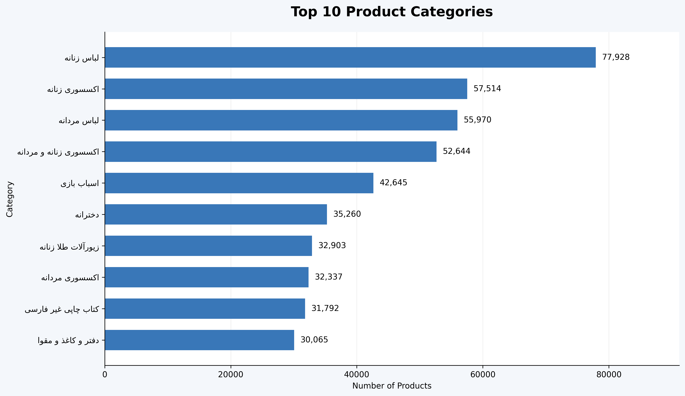
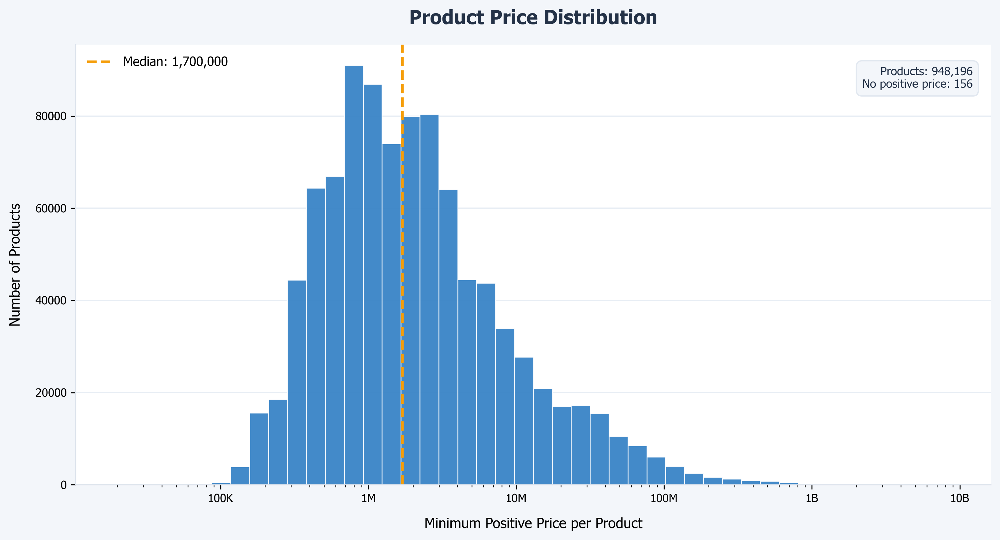
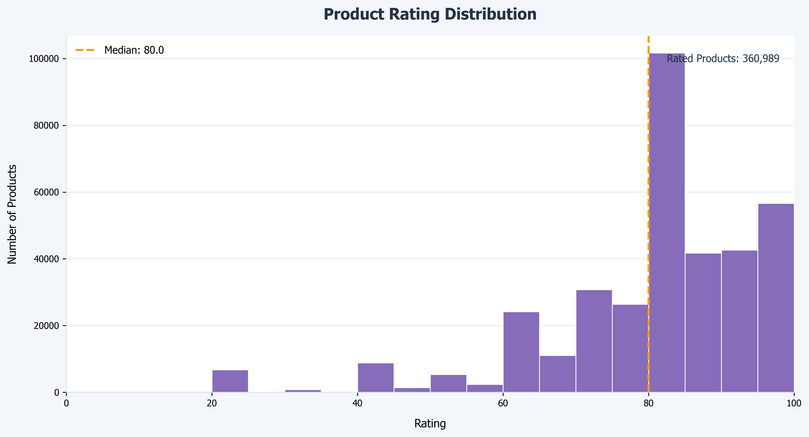
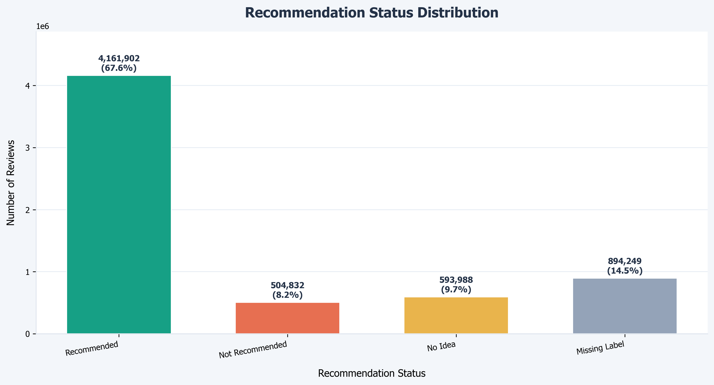

# Digikala Products & Customer Reviews --- EDA (Part 1)

## Project overview

This repository contains the first exploratory data analysis (EDA) stage
for two Digikala datasets:

-   **Products:** product metadata, categories, brands, seller offers,
    prices, and product-level ratings.
-   **Comments:** customer review text, review ratings, recommendation
    labels, buyer information, and product references.

The goal of this stage is to understand the dataset structure and
quality, examine duplicate records and product/comment relationships,
and produce a small set of descriptive visualizations. This is an EDA
deliverable, not yet a cleaned modeling dataset or a recommendation
model.

## Repository contents

Expected project structure:

``` text
.
├── README.md
├── data_overview.ipynb
├── top10_categories.png
├── price_distribution.png
├── rating_distribution.png
├── recommendation_distribution.png
├── .gitignore
└── digikala-products.csv       # local data file; do not commit
    digikala-comments.csv       # local data file; do not commit
```

The notebook currently expects both CSV files to be in the **same
working directory** as `data_overview.ipynb`.

## Dataset files

  ------------------------------------------------------------------------
  File                                Approximate size Role
  ------------------------- -------------------------- -------------------
  `digikala-products.csv`                    246.75 MB Product and
                                                       seller-offer
                                                       records

  `digikala-comments.csv`                  1,219.30 MB Customer review
                                                       records
  ------------------------------------------------------------------------

The raw CSV files are not included in this repository. They are large
files (the comments file is over 1 GB), so they should be shared with
the team through an approved shared drive or data-storage location
rather than committed to ordinary Git history. Each teammate should
place the two files beside the notebook before running it.

## Analysis workflow

The notebook covers the following steps:

1.  Load the product and comment datasets.
2.  Inspect dataset dimensions, columns, and missing values.
3.  Count exact duplicate rows and repeated IDs.
4.  Inspect repeated IDs to distinguish exact duplicates from records
    that contain different values.
5.  Remove only completely identical rows for the current EDA analysis.
6.  Aggregate product rows by product ID for product-level summaries.
7.  Analyze product categories, prices, and ratings.
8.  Analyze recommendation labels and review-body length.
9.  Check whether comment `product_id` values match product IDs.
10. Generate four descriptive charts.

### Duplicate-handling policy

`products_clean` and `comments_clean` are created using
`drop_duplicates()`. This removes **only rows that are identical across
all columns**.

Rows with the same ID but different values are deliberately retained at
this stage. In particular:

-   A product ID may have multiple seller/offer rows and different
    prices.
-   Some comment IDs still have conflicting values in core fields.
-   These cases require an explicit business/data rule before selecting
    or merging records.

Therefore, the names `products_clean` and `comments_clean` mean
*exact-duplicate rows removed*; they do not mean that every repeated ID
or data-quality issue has been resolved.

## EDA findings

### 1. Dataset size and duplicate removal

  ---------------------------------------------------------------------
  Metric                              Products                 Comments
  ------------------- ------------------------ ------------------------
  Original rows                      1,283,496                6,156,289

  Exact duplicate                      323,129                    1,318
  rows removed                                 

  Rows after exact                     960,367                6,154,971
  deduplication                                

  Unique IDs after         948,352 product IDs    6,153,060 comment IDs
  exact deduplication                          
  ---------------------------------------------------------------------

After exact deduplication:

-   **11,785** product IDs still have multiple rows.
-   **3,994** products have multiple sellers.
-   **1,911** comment rows remain beyond the first row for their comment
    IDs.
-   **343** comment IDs have conflicts in at least one of the core
    fields checked: `product_id`, `created_at`, `title`, `body`, `rate`,
    or `recommendation_status`.

The conflicting comment-field counts overlap because one comment ID can
differ in more than one field.

### 2. Top product categories

The ten most frequent product categories are:

  Category (original Persian label)     Product count
  ----------------------------------- ---------------
  لباس زنانه                                   77,928
  اکسسوری زنانه                                57,514
  لباس مردانه                                  55,970
  اکسسوری زنانه و مردانه                       52,644
  اسباب بازی                                   42,645
  دخترانه                                      35,260
  زیورآلات طلا زنانه                           32,903
  اکسسوری مردانه                               32,337
  کتاب چاپی غیر فارسی                          31,792
  دفتر و کاغذ و مقوا                           30,065

The category labels are kept in Persian because they are source values.
Chart titles and axis labels are in English.

### 3. Product prices

-   The price distribution is strongly right-skewed, so the chart uses a
    logarithmic x-axis.
-   The median of the per-product **minimum positive price** used in the
    chart is **1,700,000** in the dataset's original price unit.
-   **948,196** products have at least one positive price.
-   **156** products have no positive price.

**Important metric distinction:** the descriptive statistics in the
current main EDA cell calculate `min_price` using the minimum recorded
offer, including zero or negative values. The price histogram instead
uses the minimum **positive** offer per product. The main EDA output
reports 198 products whose raw minimum offer is non-positive, while the
histogram reports 156 products with no positive offer. These are
different definitions; align or explicitly label them before treating
the price summary as final.

The dataset's currency/unit is not established by the notebook itself.
Confirm it from the dataset documentation before describing these values
as a specific currency.

### 4. Product ratings

The product `Rate` field ranges from 0 to 100 in the supplied data.

-   **360,989** products have `Rate_cnt > 0` and are included in the
    rating chart.
-   The median rating among those products is **80**.
-   **587,363** products have both `Rate = 0` and `Rate_cnt = 0`,
    indicating no recorded rating count.
-   **15** products have `Rate = 0` while `Rate_cnt > 0`; these are
    retained as rated products rather than automatically treated as
    unrated.

The rating chart therefore filters using `Rate_cnt > 0`, not merely
`Rate != 0`.

### 5. Customer comments and recommendation labels

After exact duplicate removal, the recommendation-label distribution is:

  Recommendation status          Comments    Percentage
  ----------------------- --------------- -------------
  Recommended                   4,161,902        67.62%
  Not recommended                 504,832         8.20%
  No idea                         593,988         9.65%
  Missing label                   894,249        14.53%
  **Total**                 **6,154,971**   **100.00%**

Review-body length statistics:

-   Mean: approximately **48.2 characters**
-   Median: **29 characters**
-   90th percentile: **106 characters**
-   99th percentile: **296 characters**
-   Maximum: **4,000 characters**

Missing review text and missing recommendation labels are not silently
removed from the dataset in this EDA stage.

### 6. Product-comment relationship

The notebook reports:

-   **331,599** unique products with at least one comment.
-   **6,154,971** comment rows matched to a product ID.
-   **0** unmatched comment rows.
-   **100%** comment-row matching against the product IDs remaining
    after exact duplicate removal.

This is an ID-coverage check. It does not, by itself, validate the
correctness of every product/comment record or determine how repeated
product offers should be joined.

## Visualizations

The notebook generates the following PNG files in its current working
directory. Add these image files to the repository if the team wants
them to appear in this README on GitHub.

### Top 10 Product Categories



### Product Price Distribution



### Product Rating Distribution



### Recommendation Status Distribution



## Environment and execution

The notebook uses Python and the following packages:

**Font note:** the chart style currently requests `Tahoma`. Teammates on
Linux/macOS may not have this font installed; use an installed
Persian-capable font or configure a shared font path if Persian category
labels do not render correctly.

-   `pandas`
-   `numpy`
-   `matplotlib`
-   `arabic-reshaper`
-   `python-bidi`
-   `jupyter`

Install the dependencies:

``` bash
python -m pip install pandas numpy matplotlib arabic-reshaper python-bidi jupyter
```

Run the notebook:

``` bash
jupyter notebook data_overview.ipynb
```

Then execute the notebook from top to bottom. The two CSV files must be
available at the paths expected by the notebook.

## Before the final Git push

The analysis and charts are available, but the notebook needs a
reproducibility cleanup before this should be treated as a final, fully
reproducible team deliverable:

1.  **Fix the data-loading cell.** Use the `products_path` and
    `comments_path` variables already defined in the notebook. Consider
    `low_memory=False` and explicitly set `Category2` to a string dtype
    to avoid the mixed-type warning.
2.  **Avoid displaying the full datasets.** Replace
    `display(df_products)` and `display(df_comments)` with dataset
    shapes and `head()` previews. The files contain millions of rows.
3.  **Resolve the price-definition mismatch.** Use the same price
    definition in the descriptive statistics and histogram, or clearly
    report raw minimum offer and minimum positive offer as separate
    metrics.
4.  **Restart the kernel and run all cells in order.** The current
    notebook has non-sequential execution counts, and one cell has
    outputs while its execution count is `None`. Re-run from a fresh
    kernel and confirm there are no errors and that the outputs
    correspond to the current code.
5.  **Keep the duplicate policy explicit.** Do not drop conflicting IDs
    arbitrarily. Decide how product offers and conflicting comment IDs
    should be handled in a later cleaning stage.
6.  **Add a `.gitignore`.** At minimum, exclude the two large CSV files
    and Jupyter checkpoints:

``` gitignore
digikala-products.csv
digikala-comments.csv
.ipynb_checkpoints/
__pycache__/
```

7.  **Check the staged files.** Make sure the raw CSV files are not
    staged, and include the notebook, README, and four PNG charts.

## Suggested Git commands

After completing the cleanup:

``` bash
git status --short
git add README.md data_overview.ipynb \
  top10_categories.png \
  price_distribution.png \
  rating_distribution.png \
  recommendation_distribution.png \
  .gitignore

git status --short
git commit -m "Add initial Digikala products and reviews EDA"
git push
```

## Current status

**EDA Part 1 analysis and visualizations: completed for review.**

**Final reproducible push: pending the notebook cleanup listed above.**
The raw datasets should remain outside normal Git commits and be shared
separately with the team.
